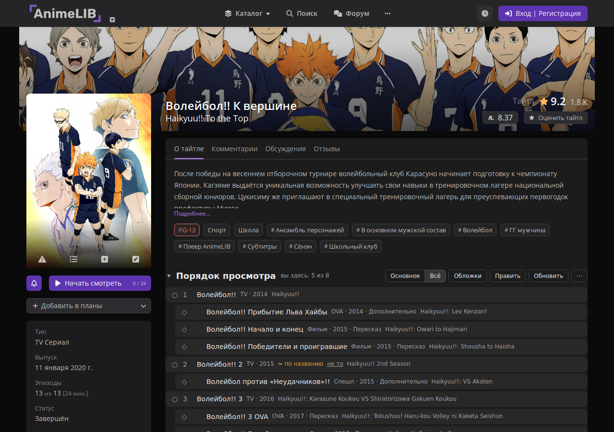
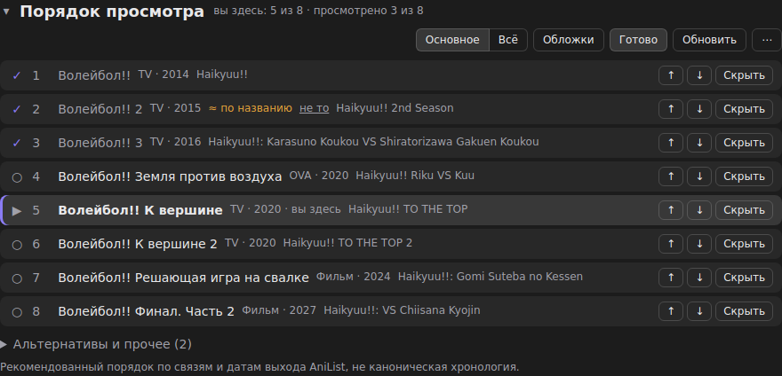
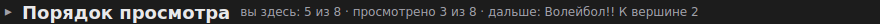
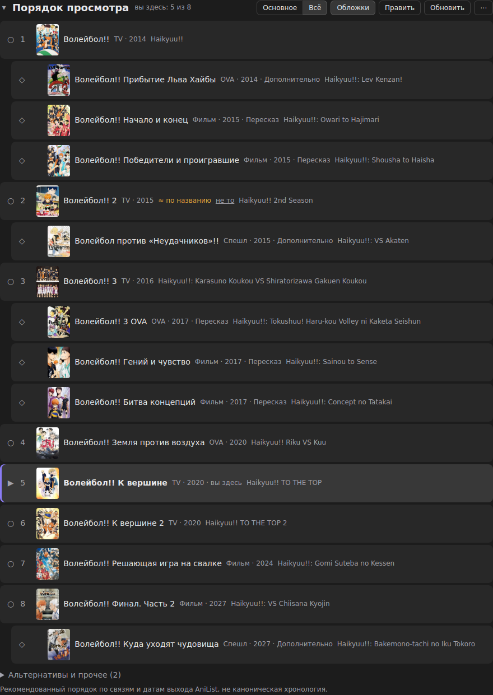
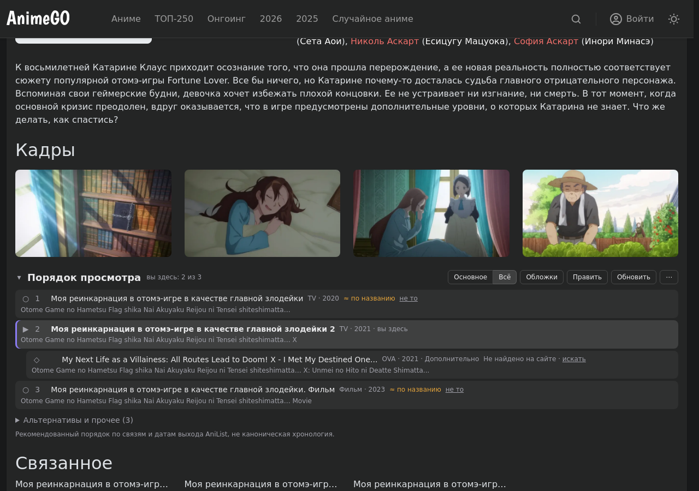

# Порядок просмотра франшизы для AnimeLib и AnimeGO

Userscript для [animelib.org](https://animelib.org) и [animego.me](https://animego.me). На странице аниме, прямо перед блоком «Связанное», появляется блок «Порядок просмотра» со всей аниме-веткой франшизы: сезоны по порядку, OVA, спешлы и фильмы между ними, альтернативные ветки отдельно. Все ссылки ведут на тот же сайт.



Скрипт не трогает плеер, авторизацию и региональные ограничения, только показывает навигацию.

## Установка

1. Поставить [Tampermonkey](https://www.tampermonkey.net/) или [Violentmonkey](https://violentmonkey.github.io/).
2. Открыть **[страницу скрипта на Greasy Fork](https://greasyfork.org/ru/scripts/600759)** и нажать «Установить этот скрипт». Также доступна [установка с GitHub](https://raw.githubusercontent.com/IvanKhramov/animelib-watch-order/main/dist/animelib-watch-order.user.js).
3. При первом запуске разрешить доступ к `graphql.anilist.co` и `raw.githubusercontent.com` («Всегда разрешать домен»). Оттуда берутся метаданные и общий каталог порядков.
4. Открыть страницу любого аниме. Блок появится сам.

Обновления менеджер подтягивает сам. В Chrome для Tampermonkey может понадобиться включить «Разрешить пользовательские скрипты»: `chrome://extensions` → Tampermonkey → «Сведения».

## Что умеет

**Три порядка просмотра.** Переключатель под заголовком выбирает «Рекомендованный», «По выходу» или «По событиям». Выбор запоминается и меняет список сразу, без повторной загрузки.

- «Рекомендованный»: скрипт автоматически ищет маршрут сообщества по точному AniList ID. Для остальных франшиз строится общий порядок первого просмотра: выбранная ветка по датам выхода, с отдельными пометками пересказов и альтернатив. Отдельно составлять таблицу для каждой франшизы не требуется.
- «По выходу»: все загруженные тайтлы, включая альтернативы и спин-оффы, по дате начала выхода. Неизвестные даты в конце, неполные даты приблизительны. Это порядок тайтлов, а не всех отдельных эпизодов.
- «По событиям»: явно названный событийный маршрут источника или проверенная редакционная поправка. Сортировка по датам выхода его не заменяет. Если событийной карты нет или её нельзя однозначно разобрать, кнопка недоступна, рядом указана причина. Такой маршрут может содержать спойлеры.

**Каталог обновляется автоматически.** Источники — r/anime Watch Order Wiki и клуб «Правильная Хронология Аниме» на Shikimori. Импорт сохраняет однозначные цепочки и диапазоны серий. Если событийные порядки различаются, под режимом «По событиям» можно выбрать источник; варианты не склеиваются. Устаревшие данные клуба помечены, непроверенные и неполные списки не импортируются.

Обновлённый файл проверяется и публикуется ежедневно, скрипт загружает его раз в сутки без переустановки. При недоступности источника остаётся сохранённая копия, затем встроенный снимок. Для Monogatari, Fate и ещё семи сложных франшиз сохранены точечные редакционные поправки. [Источники, правила импорта и ограничения](docs/watch-orders.md).

**Основная линия и всё остальное.** Текущий тайтл подсвечен. «Основное» оставляет основную линию выбранного режима, «Всё» добавляет необязательные части. Тайтлы вне проверенного маршрута остаются в отдельном раскрывающемся списке, без выдуманного места в хронологии.

**Отметки и свой порядок.** Кружок слева отмечает просмотренное. «Править» позволяет переставить части стрелками и скрыть лишнее. Правки хранятся для франшизы отдельно в каждом режиме и варианте хронологии. Отметки общие между режимами и источниками; у нескольких диапазонов одного тайтла одна общая отметка. Прежние правки сохраняются в рекомендованном режиме. В меню «⋯» можно сбросить правки текущего режима.



**Сворачивание.** Стрелка у заголовка сворачивает блок до одной строки: где вы, сколько просмотрено и что дальше.



**Обложки.** Кнопка «Обложки» показывает постеры частей. Клик открывает постер крупно: колесо масштабирует, перетаскивание сдвигает, Esc или клик мимо закрывает.



**AnimeGO.** Тот же блок и тот же вид.



Ещё в меню «⋯»: экспорт и импорт отметок в файл (перенос в другой браузер) и «Скрыть блок на этом сайте». Вернуть скрытый блок можно через меню Tampermonkey.

## Откуда данные и что хранится

- **AniList GraphQL**: связи частей (`PREQUEL`, `SEQUEL`, `SIDE_STORY` и другие), форматы, даты, обложки. Запросы без cookie, только публичные id и названия.
- **AnimeLib API**: связи тайтла, карточка (`anilist_id`, дата), поиск по каталогу. Если вы залогинены на AnimeLib, для лицензированных тайтлов используется токен самого сайта, и он уходит только в API AnimeLib.
- **AnimeGO**: данные со страниц самого сайта.

Отметки, свой порядок, настройки и кэш хранятся локально в хранилище менеджера скриптов и никуда не отправляются.

Маршруты сообщества, проверенные редакционные поправки и общий алгоритм обозначены отдельно. У маршрутов есть источники и дата обновления или проверки. Они не выдаются за официальную позицию авторов. Новые части вне выбранного маршрута остаются отдельно; о неполном списке есть предупреждение.

За автокаталогом скрипт обращается к одному общему JSON-файлу этого репозитория на `raw.githubusercontent.com`. Запрос анонимный и не содержит названия тайтла, ваших отметок или токена сайта. Содержимое фида проходит проверку формата и используется только как данные.

Если часть сопоставлена только по названию, рядом стоит «≈ по названию». Неверное сопоставление убирается кнопкой «не то».

## Неправильный порядок?

Откройте [issue](https://github.com/IvanKhramov/animelib-watch-order/issues/new/choose): ссылка на страницу, скриншот блока и как должно быть. Пока исправления нет, порядок можно поправить у себя через «Править».

## Разработка

```sh
npm install
npm run check    # tsc + vitest + сборка
npm run build    # dist/animelib-watch-order.user.js и dist/preview-inject.js
npm run update-orders # обновить общий каталог из источника
```

`dist/preview-inject.js` нужен для ручной проверки без менеджера userscript: та же логика плюс GM-обвязка поверх localStorage.

Структура `src/`: `anilistAdapter`, `matching`, `orderPolicy`, `orderProfiles` и `data/orderProfiles` (проверенные маршруты), `orderModes` (выбор режима), `customOrder`, `watchOrder` (сборка результата), `storage`, `ui`, `spaLifecycle`, `sites/` (адаптеры animelib и animego).

### Ручной smoke test

1. AnimeLib, `/ru/anime/14986--haikyuu-to-the-top-anime?ui=1`: один блок перед «Связанное», текущий тайтл под номером 5, OVA и фильмы между сезонами.
2. Переход по карточке в «Связанное» без перезагрузки: блок пересобрался, «вы здесь» переехал.
3. Переключение вкладки тайтла: блок пропадает, при возврате появляется снова, дублей нет.
4. animego, `/anime/moya-reinkarnaciya-v-otome-igre-v-kachestve-glavnoy-zlodeyki-2-1808`: блок перед «Связанное».
5. Узкий экран (около 400px), тёмная и светлая тема.

## Лицензия

[MIT](LICENSE)
